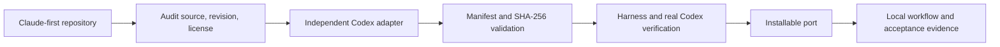

# CODEX//FORGE

**Verified Claude-first workflows for Codex developers.**

CODEX//FORGE audits Claude-first projects, preserves their licensing evidence, and publishes small Codex-native ports that can be installed, exercised, and uninstalled safely. It is designed for developers who want useful workflows—not a larger catalog for its own sake.

[Live catalog](https://jeevan-0508.github.io/codex-forge/) · [Quick start](QUICKSTART.md) · [Demos](demos/README.md) · [Security](SECURITY.md)

## In two minutes

Requirements: Node.js 20+, Git, and a working Codex CLI session for real skill discovery. No npm runtime dependencies are required.

```powershell
git clone https://github.com/Jeevan-0508/codex-forge.git
cd codex-forge
node packages/cli/cli.mjs port list
node packages/cli/cli.mjs port inspect seo-audit
node packages/cli/cli.mjs port install seo-audit --dry-run
node packages/cli/cli.mjs port install seo-audit
```

Start a new Codex session, then ask it to use `$seo-audit` on `demos/seo-audit/index.html`. The deterministic report is written by the installed local script; no site data is uploaded. Remove it when finished:

```powershell
node packages/cli/cli.mjs port uninstall seo-audit --approve
```

For a complete clean-environment measurement, run `npm run onboarding:acceptance`. It uses a temporary skill root and reports the elapsed time.

## What is published

| Port | Capability | Verification | Dependencies |
| --- | --- | --- | --- |
| `project-flow` | PRDs, task decomposition, acceptance evidence, guarded worktrees | Real Codex session | None |
| `jeffallan-architecture-designer` | Architecture and ADR guidance | Real Codex session | None |
| `jeffallan-code-reviewer` | Evidence-first code review | Real Codex session | None |
| `jeffallan-debugging-wizard` | Hypothesis-driven debugging | Real Codex session | None |
| `jeffallan-secure-code-guardian` | Secure coding review | Real Codex session | None |
| `jeffallan-test-master` | Test planning and quality gates | Real Codex session | None |
| `seo-audit` | Local HTML SEO evidence | Real Codex session | None |
| `game-prototype` | Browser-game vertical slice and checker | Real Codex session | None |

All eight ports are hash-validated and install only into Codex’s documented `~/.agents/skills` directory. Existing installations are backed up and never overwritten without approval. See the [website](https://jeevan-0508.github.io/codex-forge/) for filters, limitations, examples, and exact commands.

## How it works



Discovery never clones or executes upstream code. A port is installable only when its manifest, regular-file tree, hashes, license metadata, and runtime verification pass. External writes, credentials, MCP servers, package installation, and paid services are outside the default workflow.

## CLI reference

Run from a clone of this repository; no global installation is needed.

```sh
# Discover and inspect
node packages/cli/cli.mjs port list
node packages/cli/cli.mjs port search security
node packages/cli/cli.mjs port inspect game-prototype

# Safe installation lifecycle
node packages/cli/cli.mjs port install project-flow --dry-run
node packages/cli/cli.mjs port install project-flow
node packages/cli/cli.mjs port upgrade project-flow --dry-run
node packages/cli/cli.mjs port upgrade project-flow --approve-overwrite
node packages/cli/cli.mjs port uninstall project-flow --dry-run
node packages/cli/cli.mjs port uninstall project-flow --approve
```

The default root is `~/.agents/skills`. For isolated testing on Windows PowerShell, macOS, and Linux, set `CODEX_SKILL_ROOT` to a temporary directory. The CLI supports `--dry-run`, approval-gated replacement, backup, rollback, and recoverable uninstall. It does not edit Codex configuration.

## Evidence, not hype

The Phase 7 functional smoke benchmark ran four valid paired trials on fresh local fixtures:

- SEO audit: baseline `1/3`, assisted `3/3`.
- Browser-game slice: baseline `2/3`, assisted `3/3`.
- No timeouts; no network, credentials, paid services, or package installs.

This is a limited fixture result, not a generalized model-improvement claim. Runtime compatibility, functional correctness, latency, and quality are reported separately. See the [benchmark methodology](benchmarks/README.md) and [raw Phase 7 evidence](benchmarks/results/phase-7-latest.json). The Phase 6 evidence remains preserved in the repository and website.

An optional, local-only Headroom sidecar is documented in [docs/headroom.md](docs/headroom.md). It is disabled by default and has a separate baseline-versus-experiment command; no Headroom result is published until a real run completes.

## Security and licensing

The repository is MIT licensed. Third-party projects retain their original licenses and attribution. The installer rejects symlinks, path traversal, unexpected files, unsafe executable or hook paths, missing license evidence, unsupported dependencies, corrupted backups, and hash mismatches. Read [SECURITY.md](SECURITY.md) before reporting a vulnerability and [the Phase 7 audit](docs/phase-7-capabilities.md) for source revisions and rejected candidates.

## Development and release

```powershell
npm test
npm run verify
npm run onboarding:acceptance
npm run benchmark:phase7
```

See [CONTRIBUTING.md](CONTRIBUTING.md), [RELEASE.md](RELEASE.md), [CHANGELOG.md](CHANGELOG.md), and [demos/README.md](demos/README.md). npm publication is intentionally not enabled: `codex-forge` was checked on the public npm registry and is currently unavailable, so GitHub checkout remains the verified install route until a separately approved release.

## Roadmap

- Expand onboarding coverage across fresh Windows, Linux, and macOS runners.
- Add more narrowly scoped ports only after license, security, runtime, and functional evidence.
- Repeat benchmark trials before making any broader quality claim.
- Consider an npm release only after ownership, provenance, signing, and publication approval are complete.
